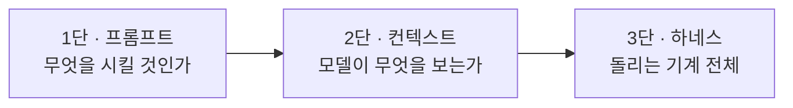
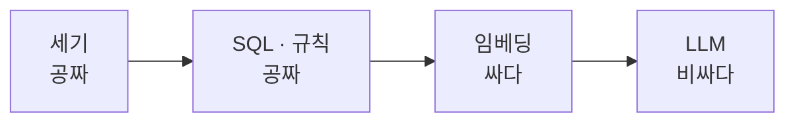
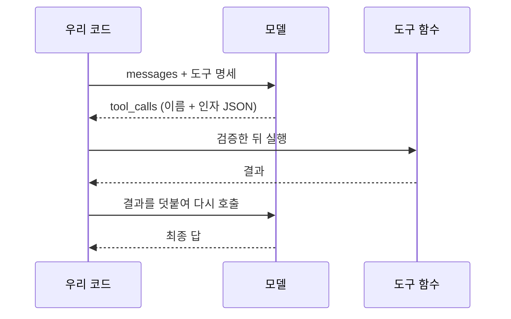
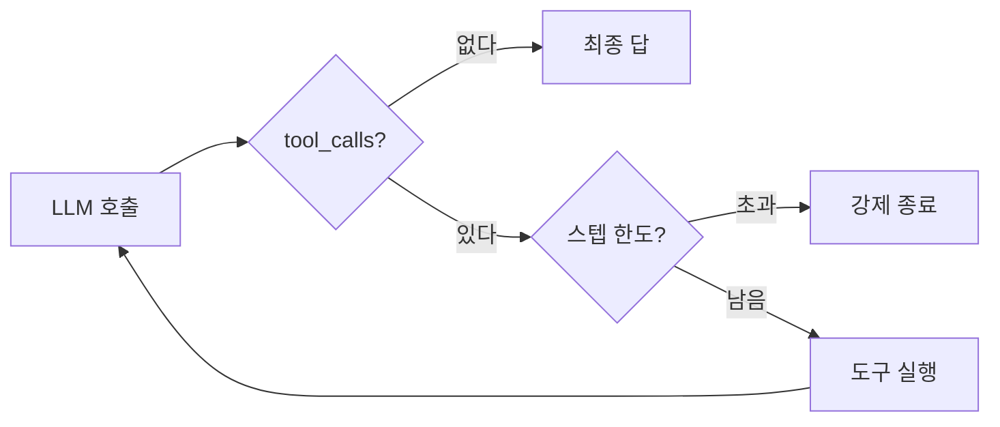
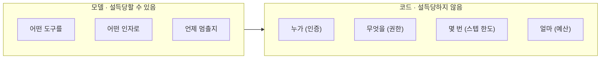
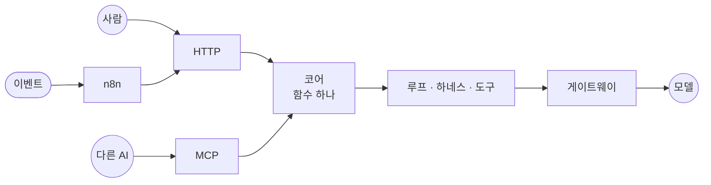
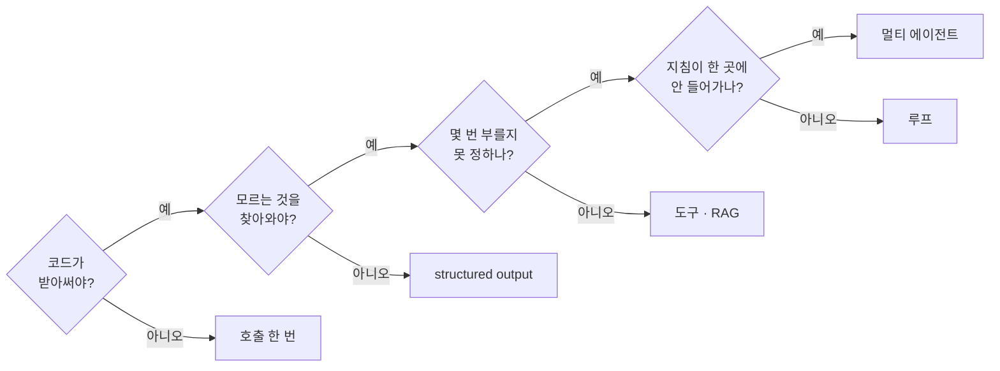
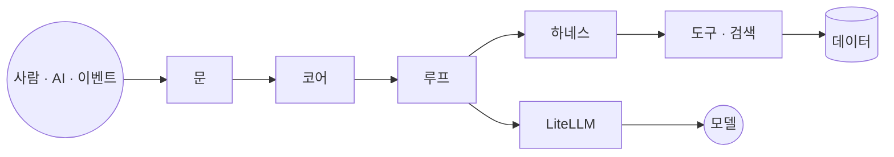

import Slide from 'stack-site-builder/components/Slide.astro';

{/* 슬라이드 작성 규칙은 docs/writing-rules.md의 "슬라이드 규칙"을 따릅니다. */}

<Slide class="cover">

# AI 서비스 엔지니어링: Track A

11주차 · AI 에이전트 총정리

*CodeCompose · 2026-10-22*

</Slide>

<Slide>

## 오늘 하는 일
::sub[새로 배우는 것도, 시연도 없습니다]

- 10주 동안 매주 다른 예제에 실려 나온 개념을 **개념의 순서로** 다시 놓습니다
- 하네스는 2·6·9주차에, RAG는 4·5주차에, 도구는 2·5주차에 나왔습니다
- 숫자는 전부 원래 회차에서 잰 것입니다
- 마지막에 **내 기획서에 대 보는 결정 지도**로 닫습니다

</Slide>

<Slide class="center">

## 오늘의 한 문장

**에이전트는 모델이 아니라,**  
**모델을 둘러싼 기계다**

</Slide>

<Slide>

### 오늘의 순서
::sub[아래 칸에서 위 칸으로 올라갑니다]

| 장 | 무엇 | 근거 회차 |
| --- | --- | --- |
| 2 | 지도 두 장 | 1 · 10주차 |
| 3 · 4 | 모델과 API · 파이프라인 | 5 · 3주차 |
| 5 · 6 | RAG · 도구 | 4 · 5 · 2주차 |
| 7 · 8 | 루프 · 하네스 | 6 · 2 · 9주차 |
| 9 | 멀티 에이전트 | 7주차 |
| 10 · 11 | 문 · 화면 | 8 · 9주차 |
| 12 · 13 | 아홉 층 · 결정 지도 | 9주차 · 전체 |

</Slide>

<Slide class="cover">

## 2장 · 지도 두 장

스택과 사다리

*1주차의 그림, 10주차의 기획서*

</Slide>

<Slide>

### 스택: 요청 하나가 다섯 층을 지난다
::sub[1주차 3장]

| 레이어 | 책임 | 우리 과정 |
| --- | --- | --- |
| Agents | 제어 루프 · 도구 호출 | LangGraph + 하네스 |
| AI Platform | 접근 · 라우팅 · 관측 | LiteLLM |
| Models | 추론 | Gemini · Claude · GPT |
| Data | 모델이 볼 재료 | PostgreSQL · Chroma |
| Infrastructure | 연산이 도는 곳 | Docker |

**Agents가 본체**입니다. 나머지는 부품을 고르고 조립합니다.

</Slide>

<Slide>

### 엔지니어링 사다리
::sub[프롬프트는 지시, 컨텍스트는 재료, 하네스는 기계]

- 1단만: 말은 잘 듣지만 아는 게 없다. **지어낸다**
- 2단까지: 맞는 재료로 답한다. 그러나 **사람이 차려 줘야** 한다
- 3단까지: 스스로 찾고, 검증하고, **실패를 복구**한다

</Slide>

<Slide>

### 에이전트 사다리: 몇 칸까지 올라갈까
::sub[10주차 기획서의 다섯 칸]

| 칸 | 무엇 | 언제 올라가나 |
| --- | --- | --- |
| 1 | 모델 호출 한 번 | 출발점 |
| 2 | structured output | 답을 코드가 받아써야 한다 |
| 3 | 도구 하나 또는 검색 | 모델이 모르는 것을 찾아와야 한다 |
| 4 | 루프 (ReAct) | 몇 번 부를지 미리 못 정한다 |
| 5 | 그래프 · 멀티 | 분기 · 병렬 · 역할 분리가 실제로 있다 |

- 하네스는 칸이 아닙니다. **3칸부터 모든 칸에 붙습니다**
- 올라가기는 쉽고, **내려오기는 지은 것을 버리는 일**입니다

</Slide>

<Slide class="cover">

## 3장 · 바닥

모델은 뇌, 서비스는 몸

*5주차*

</Slide>

<Slide>

### 능력의 경계는 도구 목록이 긋는다

- **모델**: 텍스트를 넣으면 텍스트가 나오는 함수 하나
- **서비스**: 모델에 화면 · 도구 · 루프 · 방어선을 둘러 붙인 제품. 에이전트도 여기에

같은 제품에 더 좋은 모델을 꽂아도  
붙은 것이 없으면 **여전히 오늘 날씨를 모릅니다.**

</Slide>

<Slide>

### 모델은 자신 있게 틀린다
::sub[같은 질문을 도구 없이, 도구를 쥐여 주고]

- 날씨 · 시각 · 파일: "접근할 수 없다"고 물러섰다. **안전한 실패**
- `3847 × 29183`: 망설임 없이 **112,267,021**. 정답은 112,267,001
- 도구를 쥐여 줘도 필요 없으면 부르지 않았다. 도구는 확장이지 의무가 아니다

**못 한다는 것을 늘 알려주지는 않습니다.**

</Slide>

<Slide>

### 기억은 서버가 아니라 배열에 있다

- 응답에서 쓰는 곳은 셋: `content` · `usage` · `tool_calls`
- **무상태**: 이어지는 대화는 messages 배열을 매번 다시 보내는 착시
- **배열이 곧 비용**: 토큰 곱하기 단가. 한글은 토큰이 더 든다
- **compact는 손실 압축**: 이 배열을 관리하는 일이 컨텍스트 엔지니어링

</Slide>

<Slide>

### 통합 레이어 한 벌
::sub[공식 SDK 세 벌 대신 LiteLLM]

| 장애 | 방어 |
| --- | --- |
| 순간 오류 | 재시도 · 타임아웃 |
| 모델 · 회사 장애 | 폴백 |
| 한도 초과 (429) | 백오프 |

- 프로바이더 교체는 **문자열 한 줄**
- 비용은 콜백으로 장부에, 한도와 단가는 실행 전에 코드로

</Slide>

<Slide class="cover">

## 4장 · 에이전트가 아닌 것

코드가 조종간을 쥘 때

*3주차*

</Slide>

<Slide>

### 누가 조종간을 쥐는가

| | 에이전트 | 파이프라인 |
| --- | --- | --- |
| 제어 주체 | 모델 | **코드** |
| 모델의 역할 | 조종사 | 단계별 일꾼 |
| 반복 횟수 | 가변 | 고정 상한 |
| 장점 | 미리 못 정한 일을 한다 | 예측 · 디버깅 · 비용 계산 |

**세상의 AI 서비스 대부분은 파이프라인입니다.**  
에이전트는 그 위에 얹는 선택지입니다.

</Slide>

<Slide>

### 부탁을 계약으로

- "JSON으로 짜 줘"는 **부탁**입니다
- 같은 명령을 두 번 돌리면 인사말이 붙고, 키 이름이 바뀝니다
- 문제는 한 번 잘 나오느냐가 아니라 **매번 같다는 보장이 없다**는 것

structured output은 타입을 어긴 응답을 코드에 닿기 전에 걸러 되돌립니다.  
"예쁘게 받기"가 아니라 **단계와 단계를 잇는 배선**입니다.

</Slide>

<Slide>

### 실패마다 처방이 다르다

| 실패 | 처방 |
| --- | --- |
| 환각: 데이터에 없는 음식 | 후보 목록을 **컨텍스트에 주입** |
| 형식 붕괴: 인사말, 바뀌는 키 | **스키마 강제** |
| 수치 창작: "약 200mg" | **데이터 대조 · 코드 계산** |

그리고 하나 더. **쓴 사람이 자기 출력을 검사하면 후해집니다.**  
계획자와 검증자를 다른 회사 모델로 두고, 검증자에는 폴백을 겁니다.

</Slide>

<Slide class="cover">

## 5장 · 컨텍스트

다 주지 말고, 찾아서 준다

*4주차*

</Slide>

<Slide>

### 비용 사다리
::sub[싼 층에서 풀리는 문제를 비싼 층으로 가져가지 않는다]

- 306,307건의 섭취참고량이 실은 **고유값 34개**였습니다
- 그중 28개를 정규식이 풀고, LLM에는 나머지 몇 개만 갔습니다
- "30만 건 LLM 파싱은 얼마죠?"는 **처음부터 틀린 질문**입니다

</Slide>

<Slide>

### RAG의 모양
::sub[검색 → 증강 → 생성]

| 질문의 모양 | 맡는 곳 |
| --- | --- |
| 정확하다: 이름 · 정렬 · 필터 | 정형 DB (PostgreSQL) |
| 흐릿하다: "매콤한 분식 간식" | 벡터 DB (Chroma) |

- 대체가 아니라 분담. **원본은 한 벌, 색인은 옆에**
- 검색이 추려 넣어 준 것은 **우리가 넣어 준 것**
- 모델이 필요해서 검색을 부르면 그때부터 **도구**

</Slide>

<Slide>

### 꺼 봤더니 같았다
::sub[3주차 식단 플래너에 검색을 넣고, 껐습니다]

- 검색을 꺼도 켜도 식단은 **같은 일곱 종**. 순서만 달랐다
- 500종 중 제약을 다 통과하는 것이 10개뿐이고, 코드가 그 10개를 무조건 넣었다

| | 전체 | 제약 통과 | 조건 통과분을 다 넣으면 |
| --- | --- | --- | --- |
| 저장소 샘플 | 500 | 10 | 6,484 토큰 |
| 원본 음식 DB | 19,422 | 68 | **279,248 토큰** |

**같은 기법이 규모에 따라 사치도, 필수도 됩니다.**

</Slide>

<Slide class="cover">

## 6장 · 도구

모델은 요청하고, 코드가 실행한다

*2주차 · 5주차*

</Slide>

<Slide>

### 등록에 필요한 것은 셋

- **이름**: `get_weather`
- **설명**: "도시의 현재 날씨를 조회한다"
- **입력 스키마**: `city`는 문자열이고 필수

모델에게 보이는 것은 이 셋이 전부입니다.

- 이름과 설명을 어떻게 쓰느냐가 **품질**
- 실행 앞에 무엇을 세우느냐가 **안전**

</Slide>

<Slide>

### tool call의 실체는 필드 하나

</Slide>

<Slide>

### 스키마는 형태만 안다

- 모델이 `'오사카 오션뷰 호텔'`로 예약을 요청했습니다
- 문자열이라 **스키마는 통과**. 목록에는 없는 호텔
- 실행 직전의 존재 확인이 없었다면 **유령 예약**

**LLM이 만든 값은 실행 직전에 코드로 검증한다. 예외 없이.**

그리고 실패해도 루프는 죽지 않습니다.  
**에러도 결과입니다.** 잘 쓴 에러 메시지가 복구를 만듭니다.

</Slide>

<Slide>

### 모델이 주는 인자, 코드가 넣는 인자
::sub[2주차 회의실 예약 에이전트]

| 도구 | 모델이 주는 인자 | 코드가 주입 |
| --- | --- | --- |
| `search_rooms` | 인원, 설비 | 없음 |
| `create_reservation` | 회의실, 시간, 목적 | **예약자 = 현재 사용자** |
| `cancel_reservation` | 예약 id | **요청자 id · role** |

**위험한 도구일수록 모델의 재량이 줄고, 코드가 넣는 몫이 커집니다.**

</Slide>

<Slide class="cover">

## 7장 · 루프

몇 번 부를지 모델이 정한다

*6주차*

</Slide>

<Slide>

### ReAct: 왕복 + 반복 + 종료 조건 둘

- **호출 횟수가 가변**이라는 것이 에이전트의 정의적 특징
- 멈춤조차 모델에게만 맡기지 않는다. **스텝 한도는 보험**
- 에이전트를 이해한다는 것은 **트레이스를 읽을 줄 안다**는 뜻

</Slide>

<Slide>

### 컨텍스트는 스텝마다 부푼다
::sub[6주차 실측]

- 첫 스텝 **810토큰**이 여섯 스텝 만에 **1,552토큰**
- 합계 **7,400토큰**의 대부분이 같은 내용의 재전송

매 호출이 그때까지의 배열을 전부 다시 싣습니다.  
이 우상향 계단이 **ReAct의 비용 구조**입니다.

</Slide>

<Slide>

### 루프의 스펙트럼

| 루프 | 모양 | 대가 |
| --- | --- | --- |
| ReAct | 스텝마다 LLM | 스텝마다 이력 전체 |
| Plan-and-Execute | 계획 → 실행 → 종합 | 틀리면 재계획 |
| ReWOO | 변수로 배선, 도구 병렬 | 관찰로 방향을 못 바꾼다 |
| Reflexion | 생성 → 평가 → 재시도 | 루브릭이 품질을 정의한다 |

- **적응력(ReAct) ↔ 비용(ReWOO)**
- 재계획에도 한도. 소진되면 **사람에게**
- 작은 과제에 정교한 루프를 다는 것도 **낭비**

</Slide>

<Slide class="cover">

## 8장 · 하네스

프롬프트는 부탁, 게이트는 물리 법칙

*2주차 · 6주차 · 9주차*

</Slide>

<Slide class="center">

## 모델은 설득당한다

**코드는 설득당하지 않는다**

지켜야 하는 것은 반드시 코드 층에 둡니다

</Slide>

<Slide>

### 모델이 정하는 것, 코드가 정하는 것

전제는 하나. **도구가 바깥과 닿는 유일한 통로**여야 합니다.

</Slide>

<Slide>

### 도구가 물어온 것은 데이터다

- **직접 인젝션**: 사용자가 정면으로 "규칙을 무시해"
- **간접 인젝션**: 공격자가 검색 결과 · 리뷰 · 문서 **안에** 있다

막는 법은 탐지가 아니라 **구조**입니다.

- 도구 결과를 경계 마커로 감싸고 "이 사이는 데이터"를 규칙으로
- 지시가 섞여 있어도 **숫자는 코드가 판정한다**
- 탐지는 세 층 중 **가장 약하다**

</Slide>

<Slide>

### 게이트의 목록
::sub[방어는 겹입니다]

| 게이트 | 무엇을 막나 |
| --- | --- |
| 권한 게이트 | 결제 · 삭제는 승인 없이 실행하지 않는다 |
| 데이터 경계 | 도구 결과가 지시로 읽히지 않게 |
| 출력 필터 · 경로 감금 | 비밀 패턴을 가리고, 파일 도구를 가둔다 |
| 스텝 한도 | 루프의 보험 |
| budget guard | 지갑의 보험. 경고 $0.05 · 중단 $0.10 |
| 트레이스 | 모든 판정이 한 줄로 남는다 |

</Slide>

<Slide>

### 능력을 넓히면 방어도 넓힌다
::sub[2주차 v1.5: 자연어 → SQL 도구]

| 방어 | 코드가 강제하는 것 |
| --- | --- |
| 관리자 전용 | 비관리자는 도구를 보지도 못한다 |
| 읽기 전용 롤 + 뷰 | 쓰기 · 민감 컬럼은 DB가 거부 |
| SELECT 파싱 + 상한 | 다중 문 차단, LIMIT · 타임아웃 |

9주차가 먼저 던진 질문: **짜게 할 것인가, 고르게 할 것인가.**  
고르게 하면 스키마가 막고, 짜게 하면 게이트가 둘이어야 합니다.

</Slide>

<Slide class="cover">

## 9장 · 나누기

멀티 에이전트

*7주차*

</Slide>

<Slide>

### 나누지 않는 것이 기본이다

| 무너지는 신호 | 나누는 대가 |
| --- | --- |
| 도구 목록이 길어 선택이 갈린다 | 라우팅이 LLM 호출이라 왕복이 는다 |
| 역할이 다른 지침이 서로 다툰다 | 무엇을 넘길지 설계해야 한다 |
| 컨텍스트가 붓고 찌꺼기가 따라온다 | 엉뚱한 에이전트로 보내는 새 실패 |

나누는 기준은 유행이 아니라 **무너지는 신호**입니다.

</Slide>

<Slide>

### 나누기로 했다면 정할 것 넷

| 결정 | 질문 |
| --- | --- |
| **경계** | 누가 무엇을 맡는가 |
| **이양** | 중앙으로 돌아오는가, 넘기고 손 떼는가 |
| **화물** | 요약만 보내는가, 통째로 보내는가 |
| **정지** | 왕복 · 이양 · 수정의 한도 |

앞의 셋은 설계, 마지막은 안전장치.  
**안전장치는 판단이 아니라 숫자여야 합니다.**

</Slide>

<Slide>

### 두 패턴

| | supervisor | handoff |
| --- | --- | --- |
| 제어권 | 중앙이 계속 쥔다 | 넘긴 쪽은 손을 뗀다 |
| 어울리는 문제 | 쪼개서 합친다 | 담당이 옮겨 간다 |
| 새 실패 | 과잉 라우팅 | 오배송 · 핑퐁 |

**결과를 모아야 하면 supervisor, 담당이 바뀌면 handoff.**

</Slide>

<Slide>

### 실측과 규칙
::sub[7주차 세 저장소]

- supervisor는 에이전트가 아니라 **라우터**
- 줄어든 것은 총량이 아니라 한 호출의 무게: 지침 **5분의 1**, 컨텍스트 **6분의 1**, 대신 호출은 **3회 → 5회**
- 라우팅은 흔들린다. **확실한 것은 코드가**, 애매한 것만 LLM이
- handoff 규칙: 반드시 도구로 넘기기, 되돌리지 않기, 섞이면 되묻기
- 병렬은 **작업 공간의 문제**. 버는 것은 시간뿐, 비용은 그대로

</Slide>

<Slide class="cover">

## 10장 · 문 달기

내 기능을, 남이 부를 수 있게

*8주차*

</Slide>

<Slide>

### 문은 껍데기, 코어는 하나

- 문을 달기 전에 **내 기능을 함수 하나로 말한다**. 그게 8할
- 스키마 하나가 네 곳에서: 요청 검증 · 도구 · MCP · OpenAPI

</Slide>

<Slide>

### 문마다 남은 문장

| 문 | 남은 문장 |
| --- | --- |
| HTTP | 상류 장애는 500이 아니라 502. 상태는 DB에 산다 |
| 스트리밍 | 총 시간이 아니라 첫 글자까지의 시간을 줄인다 |
| MCP | 통째로 낼지 낱개로 낼지는 통제 · 유연함 · 비용의 문제 |
| n8n | 얻는 것은 연결과 속도, 잃는 것은 테스트 · 버전 · 비용 통제 |
| 게이트웨이 | 앱은 진짜 키를 몰라도 모델을 쓴다 |

</Slide>

<Slide>

### 층은 조건으로 넣는다

| | 8주차 랩 | 9주차 랩 |
| --- | --- | --- |
| 모델을 부르는 곳 | api · mcp · n8n 셋 | api 하나 |
| 게이트웨이가 있으면 | 키 복사를 막는다 | 장애점이 하나 는다 |
| 그래서 | 값을 한다 | 걷어냈다 |

**뒤집은 것이 아니라 조건이 달라진 것입니다.**

</Slide>

<Slide class="cover">

## 11장 · 화면

에이전트를 화면 안으로

*9주차*

</Slide>

<Slide>

### 상태가 두 벌이면 무너진다

- 화면 옆에 챗 위젯: 화면의 상태와 에이전트의 상태가 따로 논다
- "이거 좀 고쳐 줘"의 **"이거"를 에이전트가 모른다**
- 프롬프트에 화면 상태를 붙이는 것은 처방이 아니다. **두 벌은 여전히 두 벌**

**화면에 AI를 덧붙이지 않는다. 에이전트를 화면 안으로 들인다.**

</Slide>

<Slide>

### AG-UI: 같은 문서를 본다

- 8주차에 손으로 지은 SSE 이벤트의 **표준판**. 없던 칸은 상태 갱신 하나
- `STATE_DELTA`는 JSON Patch. **바뀐 자리만** 흐른다
- **공유 상태의 스키마가 곧 에이전트의 권한 범위**. 스키마 밖은 못 건드린다
- 상태는 브라우저가 아니라 **DB에** 산다

</Slide>

<Slide>

### 승인 카드와 생성 UI

| | 생성 UI | 승인 카드 |
| --- | --- | --- |
| 무엇 | 컴포넌트를 화면에 낸다 | 위험한 행동 앞에서 묻는다 |
| 결과가 따라오나 | 아니오 | 예 |

- 같은 메커니즘. 차이는 **결과가 따라오느냐**뿐
- 승인은 멈춰 기다리는 것이 아니라 **두 번 도는 것**
- 그리고 **대부분의 개인 프로젝트에는 공유 상태가 필요 없습니다**

</Slide>

<Slide>

### 한 줄이 아홉 층을 지난다
::sub[9주차 10장 · 12장]

- 아홉 층 중 9주차에 새로 지은 것은 **둘**. 나머지 일곱은 5\~8주차의 것
- 주제를 갈아 끼울 때 바뀌는 것은 **도구와 데이터**, 층의 구조는 그대로
- 가장 무서운 실패는 **조용하다**: 검색이 비면 모델이 지표를 지어낸다
- 코드에 있는데 프롬프트에 없는 것은 **모델에게 없는 것**
- 검증의 오탐은 조용히 비싸다: 고치자 모델 호출 **19회 → 5회**

</Slide>

<Slide class="cover">

## 13장 · 결정 지도

언제 무엇을 쓰나

*내 기획서에 대 보기*

</Slide>

<Slide>

### 질문으로 고른다
::sub["예"가 나온 것만 넣습니다]

되돌릴 수 없는 행동(쓰기 · 삭제 · 결제 · 질의 생성)이 있으면  
어느 칸에서 멈추든 **하네스는 필수**입니다.

</Slide>

<Slide>

### 조건이 없으면 넣지 않는다

| 조건 | 들일 것 | 없으면 |
| --- | --- | --- |
| 모르는 지식이 필요하다 | RAG · 검색 | 프롬프트에 다 들어간다 |
| 분기 · 재시도 · 병렬이 있다 | 그래프 | 손 루프로 충분 |
| **되돌릴 수 없는 행동이 있다** | **하네스** | 조회만이면 얇아도 된다 |
| 부르는 곳이 둘 이상이다 | 게이트웨이 | 직접 호출이 단순 |
| 화면과 에이전트가 같은 것을 고친다 | 공유 상태 | 폼형이 정직하다 |

</Slide>

<Slide>

### 10주 동안 반복된 원칙 넷

| 원칙 | 나온 자리 |
| --- | --- |
| **확실한 것은 코드가** | 권한(2) · 파이프라인(3) · 하이브리드 라우팅(7) |
| **싼 층 먼저** | 비용 사다리(4) · 작은 과제엔 단순한 루프(6) |
| **한도는 숫자로** | 루프 가드(2) · 스텝 한도 · budget guard(6) · 정지(7) |
| **꺼 보고 재 본다** | 검색 끄기(4) · 하네스 절제(6) · 단일 vs supervisor(7) |

</Slide>

<Slide>

### 내 기획서에 대 보기
::sub[docs/proposal.md를 열고]

- AI 자리를 질문에 넣었을 때 멈추는 칸이 **기획서의 사다리 칸과 같은가**
- 더 높다면 "몇 번 부를지 못 정하는" 요청을 **하나 예로 들 수 있는가**. 못 들면 한 칸 내린다
- **되돌릴 수 없는 행동**이 있는가. 있다면 어떤 게이트를 세우는가
- 모델이 주는 인자와 **코드가 넣는 인자**를 나눠 적었는가
- 정답 10건으로 **AI 없는 기준선**과 견줄 수 있는가

</Slide>

<Slide>

### 이 세션이 남기는 것

- 에이전트는 모델이 아니라 **모델을 둘러싼 기계**다
- 세상의 AI 서비스 대부분은 파이프라인이다. 에이전트는 그 위의 선택지다
- 다 주지 말고 찾아서 준다. 그리고 **꺼 보고 재 본다**
- 모델은 요청하고 **코드가 실행한다**. 값은 실행 직전에 검증한다
- 스텝 한도는 보험이고, **게이트는 물리 법칙**이다
- 나누지 않는 것이 기본이다. 문은 껍데기고 코어는 하나다
- 층은 배웠다고 넣는 것이 아니라 **조건이 있을 때** 넣는다

</Slide>

<Slide>

### 한 장으로

</Slide>

<Slide class="center">

## 이번 주

**v0.2를 배포하고, v0.5에서 AI를 얹습니다**

층을 하나 더 들이고 싶어지면 결정 지도의 질문에 다시 넣어 보세요  
대부분의 답은 "아직 아니오"입니다

</Slide>
